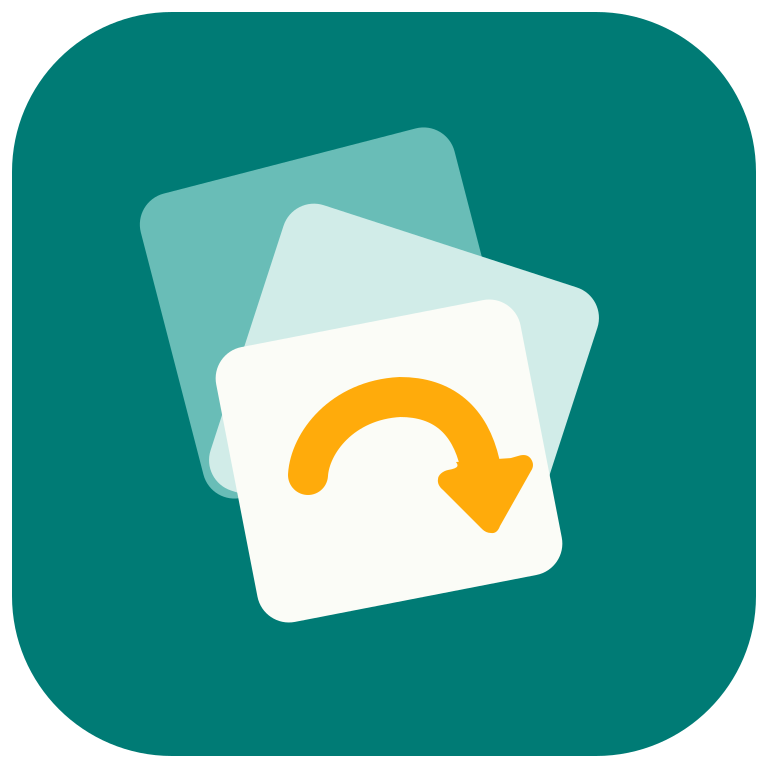

<p align="center">
  
</p>

# Repetorium

**Practice, Review, Apply**

Repetorium is an offline-first desktop app for practicing knowledge, building
durable recall, and applying ideas. The app ships without learning content.
Create a content pack in the supported format or use the downloadable
`RepetoriumSkills.MD` instructions to map material you already have.

## Developer Setup

Requires Python 3.12 or newer and `uv`.

```powershell
uv sync
uv run repetorium
uv run pytest
uv run ruff check src tests scripts/build.py
```

The development checkout intentionally has no default learning library. Import
a content-pack ZIP through **Library** to begin, or set
`REPETORIUM_CONTENT_DIR` to an existing content directory before launch. See
[Content Pack Format](KNOWLEDGE_LIBRARY.md) for the workflow and
[RepetoriumSkills.MD](src/repetorium/resources/RepetoriumSkills.MD) for the
supported file format.

## Content Packs and Progress

Library can import, export, rename, and delete content packs. Renaming changes
the title shown in Repetorium without changing the pack's contents. Settings
lets you choose any installed packs to practice, from one pack to all packs.
The weekly lesson goal can be divided among the selected packs, and pack-level
goals always add up to the overall goal. Use each pack's **Info** button to
review its purpose, contents, authoring intent, quiz inventory, and work-in-
progress notes. Combined practice namespaces colliding skill IDs so both
versions remain usable.

Exports contain the selected library and a point-in-time snapshot of mastery,
review scheduling, streak, daily XP/study totals, and lifetime totals. After
importing an exported ZIP, you can choose to restore its snapshot. Restoring
replaces saved state for matching skill IDs, preserves unrelated skills, and
never reduces existing XP or lifetime study-time totals. Question-level attempt
history, raw answers, and personal notes are not included.

Progress is stored locally in `knowledge.sqlite3` under the platform's
user-data directory (`%LOCALAPPDATA%\repetorium` on Windows). Set
`REPETORIUM_DATA_DIR` to use a separate profile. Progress follows stable skill
IDs across pack changes; changing a pack ends active study sessions but retains
saved progress. On POSIX systems the profile directory must be owned by the
current user and is restricted to that user.

## Learning Model

The tutor supports prerequisite-aware lessons, practice, spaced review,
diagnostics, mock assessments, and concept reflections. Mastery status and XP
are practice signals, not claims about intelligence or guaranteed long-term
retention. The app works offline and does not call an AI service.

## Build

Builds are host-native: build the Windows executable on Windows and the Linux
AppImage on Linux. See [Building](docs/BUILDING.md).

```bash
uv run python scripts/build.py --target linux
```

End-user releases are native application binaries. The source code and
application are available under the MIT License. The application binary
contains the app and content-format instructions, but no learning pack. Users
import content packs themselves. Third-party components and bundled assets may
have separate license terms; see their notices, including
[the icon license](src/repetorium/qml/icons/LICENSE).
To add the Linux build to your desktop menu after building, run:

```bash
uv run python scripts/build.py --target linux --install-desktop-entry
```

On Windows, build the executable and Microsoft Store MSIX package on a Windows
host. See [Windows MSIX packaging](docs/BUILDING.md#windows-msix-for-microsoft-store)
for the Partner Center identity values and Windows SDK prerequisites:

```powershell
uv run --group build python scripts/build.py --target windows
```

Set the Store identity values in a local `.env` file (start from
[`.env.example`](.env.example)). `.env` is ignored by Git. These values are
public package metadata, not credentials.

## Project References

See [Learning Software](docs/LEARNING_SOFTWARE.md) for how the tutor works and
[Learning Software Design and Evidence](docs/LEARNING_DESIGN.md) for its
learning mechanisms and supporting research. The shared cross-platform UI
language is described in [Design Language](docs/DESIGN_LANGUAGE.md).

Repetorium uses Python, Qt/PySide6, SQLite, PyYAML, platformdirs, and Lucide.
Third-party notices for the bundled icons are in
[the icon license](src/repetorium/qml/icons/LICENSE).

## License

Repetorium is licensed under the [MIT License](LICENSE). This license applies
to the Repetorium source code and application. Third-party components and
bundled assets remain subject to their own licenses, identified with those
components.

## Issues and Support

Repetorium is provided as is, without user support. Issues are for
reproducible bug reports only; they are read periodically, but responses and
fixes are not guaranteed. Questions, help requests, and feature requests may
be closed without reply.

## Contributing

Repetorium is open source under the MIT License, but I maintain this repository
for my own use and will not be accepting pull requests. You are welcome to fork
the repository and build or adapt it as you like under the terms of the
license.

For the maintainer's local development setup, use:

```bash
uv run pytest
uv run ruff check src tests scripts/build.py
```
